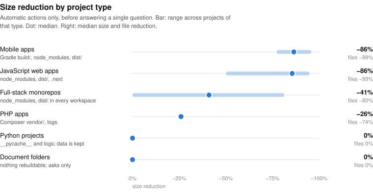
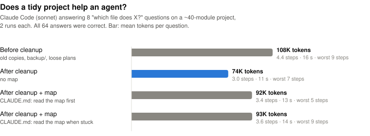

<p align="center">
  
</p>

<h1 align="center">&nbsp;Thanks Mom</h1>

<p align="center">
  <b>A Claude Code skill that cleans up messy project folders,<br>and never throws out anything you still need.</b>
</p>

<p align="center">
  <a href="https://github.com/googool2/thanks-mom/actions/workflows/bench.yml"></a>
  <a href="CHANGELOG.md"></a>
  <a href="LICENSE"></a>
  <a href="#quick-start"></a>
</p>

---

**Mom has seen it all.** The 300 MB `node_modules` nobody remembers installing. The `PLAN_v2_FINAL_REAL.md`. The PDF reader the agent wrote four times because it never found the first one.

**Tidy means careful, not empty.** She checks for the lockfile before she touches `node_modules`. She writes down your venv's packages before she empties it. She looks for anything that still uses a file before she boxes it up. Nothing leaves the room without a labeled box it can come back from.

**Unsure? She asks. No answer? It stays.**

A clean room isn't an empty room. It's a room where you can find everything.

<picture>
  <source media="(prefers-color-scheme: dark)" srcset="assets/stats-dark.svg">
  
</picture>

## What she does

Say **"thanks mom"** inside a project and Claude:

| | |
|---|---|
| 🧺 **Deletes what can be rebuilt** | `node_modules`, `.venv`, `vendor/`, `Pods/`, build output and caches, only when a lockfile or build script proves they come back |
| 📦 **Boxes up leftovers** | logs, temp files, `*_old` and `*_backup` files go into a verified zip in `.mom/` |
| 🙋 **Asks about the rest** | one short question per kind of thing, with the facts: size, last change, whether anything uses it |
| 🧰 **Merges copy-paste scripts** | near-identical one-off scripts become one reusable tool in `tools/` |
| 🗂️ **Tidies the root** | loose docs move into `docs/` in code projects |
| 🗺️ **Leaves a map** | `PROJECT_MAP.md` explains every folder. In large projects, a line in `CLAUDE.md` tells agents to read it first |
| 🌳 **Finds forgotten worktrees** | lists every git worktree with its size, unsaved changes and unmerged commits, and which ones are safe to remove |
| 📊 **Surveys all your projects** | one read-only report of which projects are heavy and how much of each can be rebuilt |
| ↩️ **Undoes everything** | `mom.py undo .` puts every boxed-up and moved file back, byte for byte |

<p align="center"><b>Always say "thank you" to her.</b></p>

## Quick start

In Claude Code:

```
/plugin marketplace add googool2/thanks-mom
/plugin install thanks-mom@thanks-mom
```

Then open a messy project and say **"thanks mom"**. It needs Python 3.10 or newer, and nothing else to install.

<details><summary>Without the plugin system</summary>

```bash
git clone https://github.com/googool2/thanks-mom
cp -r thanks-mom/skills/thanks-mom ~/.claude/skills/        # every project
# or: cp -r thanks-mom/skills/thanks-mom .claude/skills/    # just this one
```

</details>

## How a cleanup goes

1. **Scan.** `mom.py scan .` sorts every file and changes nothing. The agent reads a short summary, not your files:

   ```
   Thanks Mom 1.1.1 scanned 11,214 files (320.9 MB).
     delete     6 items   317.1 MB   regenerable / junk
     archive    6 items     1.9 MB   boxed up in a zip, recoverable
     move       4 items     3.0 KB   tidied into folders
     ask       10 items     1.1 MB   mom needs to ask you
   ASK (kept unless you decide otherwise):
       #3     128.9 KB  output  - looks like a leftover folder (2 files), untouched 0d
       4 items      676 B  one-off script at the root?  (ids 14,16,19,26; e.g. check_db.py, debug_api.py, read_csv_quick.py)
       #24        60 B  src/shopbot/backup.py  - throwaway name (tmp/old/backup), but referenced by tests/test_core.py, untouched 0d
     similar scripts S1 (merge into one tool?): #19 read_csv_quick.py, #20 read_docx_tmp.py, #21 read_pdf_tmp.py, #27 read_xlsx.py
   ```

   (Excerpt from the synthetic benchmark's scan.)

2. **Questions.** Claude asks about each line, with three options: **Keep it**, **Box it up** or **Throw it out**. Anything you skip stays where it is.
3. **Apply.** `mom.py apply .` writes the zip, verifies it, and only then removes anything.
4. **Map.** Claude writes `PROJECT_MAP.md` and a short pointer in `CLAUDE.md`, then reports what changed and how to undo it.

## Benchmarks

### Results by project type

<picture>
  <source media="(prefers-color-scheme: dark)" srcset="assets/by-type-dark.svg">
  
</picture>

| Project type | Size | Files | Removed automatically |
|---|---:|---:|---|
| Mobile apps | −77% to −96% | −99% | Gradle `build/`, `node_modules`, `dist/` |
| JavaScript web apps | −50% to −95% | −88% to −99% | `node_modules`, `dist/`, `.next` |
| Full-stack monorepos | up to −81% | up to −97% | `node_modules` and `dist/` in every workspace |
| PHP apps | −26% | −74% | Composer `vendor/`, logs |
| Python projects | 0% | ~0% | `__pycache__`, logs. Their size is data, which mom only asks about |
| Document folders | 0% | up to −1% | Nothing rebuildable. Mom only asks |

These are **automatic actions only**: what mom does before you answer a single question. Anything you approve when she asks, like old builds, leftover folders or big archives, comes on top. A typical project leaves 4.5 questions (median).

<sub>Measured on copies of real-world projects across these six types: 362,623 files, 20.7 GB in total. The copies were deleted afterwards, and no project names or contents are published. Ranges are min to max across projects of a type. Raw totals: [bench/realworld.json](bench/realworld.json).</sub>

### Accuracy and safety

Every automatic decision was reviewed by hand. That covers each delete, box-up and move made without asking.

| | v1.0 | v1.1 |
|---|---:|---:|
| Wrong automatic decisions (would break something until `undo`) | 11.5% | **0%** |
| Debatable automatic decisions | 86.9% | 0% |
| Files lost | 0 | 0 |
| Files restored byte for byte by `undo` | 100% | 100% |
| `git status` identical after `undo` | ✅ | ✅ |
| Questions per project (median) | 11.5 | 4.5 |

v1.0 never lost a file, but it trusted one bad rule: identical files are junk. In real projects they're often deliberate. Examples are experiment outputs, app resources and files inside a packaged app. v1.1 treats duplicates as a question and stays out of folders it can't prove are rebuildable. The details are in the [CHANGELOG](CHANGELOG.md).

Run the same test on your own projects with `python bench/realworld.py WORKDIR results.json PROJECT_DIR...`. It works on copies and deletes them when done.

### Does it help agents?

Same project, three states, measured with headless Claude Code: eight "which file does X?" questions, two runs each.

<picture>
  <source media="(prefers-color-scheme: dark)" srcset="assets/agent-dark.svg">
  
</picture>

**The cleanup is what helps.** Without the old copies and leftovers to wade through, the agent used **31% fewer tokens and 31% less time**, and got every answer right in every state. A project map did **not** make it faster on a project this size. Telling the agent to read the map first cost about 25% more tokens than plain search, though it did cap the worst case at 5 steps. So mom writes `PROJECT_MAP.md` for people, and adds the "read the map first" line to `CLAUDE.md` only in large projects. Rerun it yourself with `python bench/agent_eval.py WORKDIR`, which uses your Claude Code quota (about $2.50 here).

### Synthetic benchmark (CI)

A messy Python + Next.js project with real `npm` and `pip` installs and seven **traps** that look like junk but aren't. Examples are a module named `backup.py`, a hand-made `dist/`, `.env`, and uploads a database points to. Every question gets the most aggressive answer. It runs on Linux, macOS and Windows on every push.

<picture>
  <source media="(prefers-color-scheme: dark)" srcset="assets/benchmark-dark.svg">
  
</picture>

Full report: [bench/RESULTS.md](bench/RESULTS.md).

## Safety rules

1. **Nothing is removed until the zip is written and verified.** Moves are recorded too, so `undo` can reverse them.
2. **Deleted means rebuildable.** `node_modules` and `vendor/` are deleted only next to a lockfile. A `.venv` only after its package list is saved, and build output only when a build script exists.
3. **Unprovable folders are left alone.** A `dist/`, `build/` or `bin/` that can't be shown to be rebuildable may be an app you ship, so mom doesn't look inside.
4. **Anything still in use becomes a question.** Before boxing up or moving a file, mom searches the code, configs, LaTeX and notebooks that stay. She matches the name with and without its extension.
5. **Duplicates are a question, not a decision.**
6. **Data folders are hands-off.** Files in `data/`, `storage/`, `uploads/` and similar folders are often referenced by a database, so mom only asks about them.
7. **A move never exposes a gitignored file.**
8. **Protected, always:** `.git`, `.env*`, lockfiles, manifests, README, LICENSE, `CLAUDE.md`, `.claude/`, `.github/`, `tools/`. Other git checkouts (worktrees, submodules) and empty folders are left alone too.
9. **No answer means it stays.**
10. **Code is only reorganized with clean git and passing tests**, and the tests run again afterwards.

## For agents: stop rewriting the same script

Agents often write `read_pdf_tmp.py`, then `read_docx_tmp.py`, then `read_xlsx.py`: the same twenty lines each time. Mom spots near-identical scripts, Claude merges them into one tool that takes arguments, and two lines go into `CLAUDE.md`:

```
## House rules
- Reusable helpers live in tools/. Use or extend one before writing a new script.
- Throwaway scripts go in .scratch/ (gitignored), never the project root.
```

In large projects a third line, `Read PROJECT_MAP.md before searching for files.`, points agents at the map. The whole skill costs about 1.6k tokens, and a scan summary about 400.

## Without an agent

```bash
MOM=skills/thanks-mom/scripts/mom.py
python $MOM scan .                # plan + summary, changes nothing
python $MOM apply . --archive 3,4 --keep 7 --move 10-36
python $MOM undo .                # put everything back
python $MOM map .                 # folder tree for PROJECT_MAP.md
python $MOM worktrees .           # which git worktrees are safe to remove (read-only)
python $MOM report ~/Projects     # every project: size, rebuildable, worktrees (read-only)
python $MOM prune . --days 30     # delete safety zips older than 30 days
```

Without answers, `apply` only does what the plan marked as safe. Ids accept ranges.

## Versions

Releases are git tags, with notes in [CHANGELOG.md](CHANGELOG.md).
- **Major versions** can change what gets removed, so read their notes first.
- **Minor and patch versions** only add rules or fix bugs, and never loosen a safety rule.

Plugin installs update with `/plugin marketplace update thanks-mom`. To check what you have, run `mom.py --version`.

**Next up:** recognizing framework caches inside data folders (Laravel `storage/framework/cache`, for example), so they stop being questions.

Issues are welcome. Please include `mom.py --version` and the scan summary.

## Limits

- The reference check is text search. Paths built at runtime (`"data_" + kind + ".csv"`) can be missed. That's why uncertain files are asked about or boxed up, never deleted.
- Rebuilding deleted dependencies (`npm ci`, `pip install`, `composer install`) needs network.
- The real-world benchmark used one developer's projects on Windows, and the agent that wrote the tool reviewed it. Your mileage depends on how messy your room is.

---

<p align="center"><i>Everything you need is still here. The rest is in a labeled box.</i></p>

<p align="center"><sub>MIT licensed. See <a href="LICENSE">LICENSE</a>.</sub></p>
