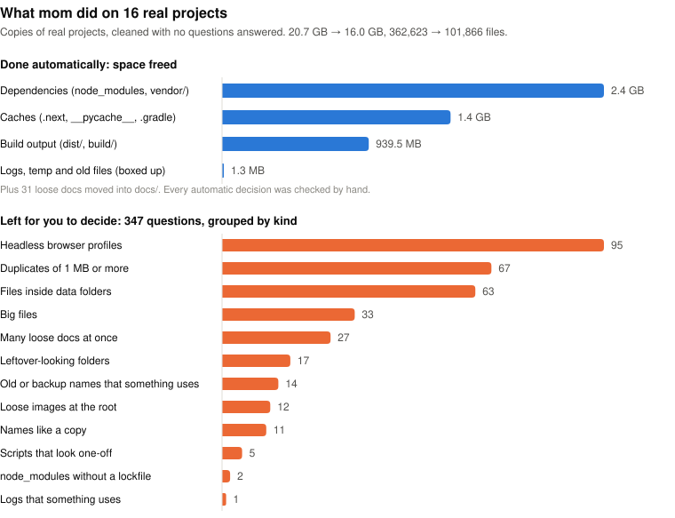
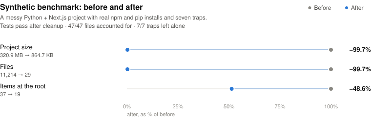

<p align="center">
  
</p>

<h1 align="center">Thanks Mom</h1>

<p align="center">
  <b>A Claude Code skill that cleans up messy project folders,<br>and never throws out anything you still need.</b>
</p>

<p align="center">
  <a href="https://github.com/googool2/thanks-mom/actions/workflows/bench.yml"></a>
  <a href="CHANGELOG.md"></a>
  <a href="LICENSE"></a>
</p>

---

**Mom has seen it all.** The 300 MB `node_modules` nobody remembers installing. The `PLAN_v2_FINAL_REAL.md`. The PDF reader the agent wrote four times because it never found the first one.

**Tidy means careful, not empty.** She checks for the lockfile before she touches `node_modules`. She writes down your venv's packages before she empties it. She looks for anything that still uses a file before she boxes it up. Nothing leaves the room without a labeled box it can come back from.

**Unsure? She asks. No answer? It stays.**

A clean room isn't an empty room. It's a room where you can find everything.

<picture>
  <source media="(prefers-color-scheme: dark)" srcset="assets/stats-dark.svg">
  
</picture>

## What she does

Say **"thanks mom"** inside a project and Claude:

| | |
|---|---|
| 🧺 **Deletes what can be rebuilt** | `node_modules`, `.venv`, `vendor/`, `Pods/`, build output and caches, only when a lockfile or build script proves they come back |
| 📦 **Boxes up leftovers** | logs, temp files, `*_old` and `*_backup` files go into a verified zip in `.mom/` |
| 🙋 **Asks about the rest** | one short question per kind of thing, with the facts: size, last change, whether anything uses it |
| 🧰 **Merges copy-paste scripts** | near-identical one-off scripts become one reusable tool in `tools/` |
| 🗂️ **Tidies the root** | loose docs move into `docs/` in code projects |
| 🗺️ **Leaves a map** | `PROJECT_MAP.md` plus a three-line pointer in `CLAUDE.md`, so an agent finds its way after a context reset |
| ↩️ **Undoes everything** | `mom.py undo .` puts every boxed-up and moved file back, byte for byte |

<p align="center"><b>Always say "thank you" to her.</b></p>

## Quick start

```bash
git clone https://github.com/googool2/thanks-mom
cp -r thanks-mom/thanks-mom ~/.claude/skills/        # every project
# or: cp -r thanks-mom/thanks-mom .claude/skills/    # just this one
```

Open Claude Code in a messy project and say **"thanks mom"** (or `/thanks-mom`). It needs Python 3.10 or newer, and nothing to install.

## How a cleanup goes

1. **Scan.** `mom.py scan .` sorts every file and changes nothing. The agent reads a short summary, not your files:

   ```
   Thanks Mom 1.1.1 scanned 11,214 files (320.9 MB).
     delete     6 items   317.1 MB   regenerable / junk
     archive    6 items     1.9 MB   boxed up in a zip, recoverable
     move       4 items     3.0 KB   tidied into folders
     ask       10 items     1.1 MB   mom needs to ask you
   ASK (kept unless you decide otherwise):
       #3     128.9 KB  output  - looks like a leftover folder (2 files), untouched 0d
       4 items      676 B  one-off script at the root?  (ids 14,16,19,26; e.g. check_db.py, debug_api.py, read_csv_quick.py)
       #24        60 B  src/shopbot/backup.py  - throwaway name (tmp/old/backup), but referenced by tests/test_core.py, untouched 0d
     similar scripts S1 (merge into one tool?): #19 read_csv_quick.py, #20 read_docx_tmp.py, #21 read_pdf_tmp.py, #27 read_xlsx.py
   ```

   (Excerpt from the synthetic benchmark's scan.)

2. **Questions.** Claude asks about each line, with three options: **Keep it**, **Box it up** or **Throw it out**. Anything you skip stays where it is.
3. **Apply.** `mom.py apply .` writes the zip, verifies it, and only then removes anything.
4. **Map.** Claude writes `PROJECT_MAP.md` and a short pointer in `CLAUDE.md`, then reports what changed and how to undo it.

## Results

### On real projects

Mom was run on copies of **16 real projects** of different kinds: web and mobile apps, monorepos, PHP and Python code, research folders and plain document folders. Each copy was deleted afterwards. Every automatic decision was **reviewed by hand**. That means each delete, box-up and move made without asking.

<picture>
  <source media="(prefers-color-scheme: dark)" srcset="assets/realworld-dark.svg">
  
</picture>

The first version did not pass this test cleanly, and the fixes went into 1.1:

| | 1.0 | 1.1 |
|---|---:|---:|
| Automatic decisions | 8,446 | 89 |
| Wrong (would break something until `undo`) | 972 | **0** |
| Harmless but debatable | 7,337 | 0 |
| Questions left for you | 637 | 347 |

Most of 1.0's mistakes came from one bad assumption: that identical files are junk. In real projects they're often deliberate. Examples are experiment outputs, app resources and files inside a packaged app. In 1.1, duplicates are only ever a question, and folders that can't be proven rebuildable are not looked into. The full list is in the [CHANGELOG](CHANGELOG.md).

| Mechanical checks (both versions, every project) | Result |
|---|---|
| Original files accounted for after cleanup: in place, moved, or in the zip | ✅ 725,245 checked, 0 lost |
| Files back byte-for-byte after `undo` (rebuildable dependencies excluded) | ✅ all |
| `git status` identical after `undo` | ✅ 15 of 15 |
| Ignored files made visible to git by a move | ✅ 0 |

You can run the same test on your own projects: `python bench/realworld.py WORKDIR results.json PROJECT_DIR...`. It works on copies and deletes them when done.

### Synthetic benchmark

A messy Python + Next.js project with real `npm` and `pip` installs, plus seven **traps** that look like junk but aren't (a module named `backup.py`, a hand-made `dist/`, `.env`, uploads a database points to, ...). Every question gets the most aggressive answer. CI runs it on Linux, macOS and Windows on every push.

<picture>
  <source media="(prefers-color-scheme: dark)" srcset="assets/benchmark-dark.svg">
  
</picture>

Full report: [bench/RESULTS.md](bench/RESULTS.md).

## Safety rules

1. **Nothing is removed until the zip is written and verified.** Moves are recorded too, so `undo` can reverse them.
2. **Deleted means rebuildable.** `node_modules` and `vendor/` are deleted only next to a lockfile. A `.venv` only after its package list is saved, and build output only when a build script exists.
3. **Unprovable folders are left alone.** A `dist/`, `build/` or `bin/` that can't be shown to be rebuildable may be an app you ship, so mom doesn't look inside.
4. **Anything still in use becomes a question.** Before boxing up or moving a file, mom searches the code, configs, LaTeX and notebooks that stay. She matches the name with and without its extension.
5. **Duplicates are a question, not a decision.**
6. **Data folders are hands-off.** Files in `data/`, `storage/`, `uploads/` and similar folders are often referenced by a database, so mom only asks about them.
7. **A move never exposes a gitignored file.**
8. **Protected, always:** `.git`, `.env*`, lockfiles, manifests, README, LICENSE, `CLAUDE.md`, `.claude/`, `.github/`, `tools/`. Other git checkouts (worktrees, submodules) and empty folders are left alone too.
9. **No answer means it stays.**
10. **Code is only reorganized with clean git and passing tests**, and the tests run again afterwards.

## For agents: stop rewriting the same script

Agents often write `read_pdf_tmp.py`, then `read_docx_tmp.py`, then `read_xlsx.py`: the same twenty lines each time. Mom spots near-identical scripts, Claude merges them into one tool that takes arguments, and three lines go into `CLAUDE.md`:

```
## Project map & house rules
- Read PROJECT_MAP.md before searching for files.
- Reusable helpers live in tools/ (listed in PROJECT_MAP.md). Use or extend one before writing a new script.
- Throwaway scripts go in .scratch/ (gitignored), never the project root.
```

It's a pointer, not an `@import`, so it costs about 60 tokens per session. The whole skill costs about 1.4k tokens, and a scan summary about 400.

## Without an agent

```bash
python thanks-mom/scripts/mom.py scan .        # plan + summary, changes nothing
python thanks-mom/scripts/mom.py apply . --archive 3,4 --keep 7 --move 10-36
python thanks-mom/scripts/mom.py undo .        # put everything back
python thanks-mom/scripts/mom.py map .         # folder tree for PROJECT_MAP.md
```

Without answers, `apply` only does what the plan marked as safe. Ids accept ranges.

## Versions

Releases are git tags, with notes in [CHANGELOG.md](CHANGELOG.md).
- **Major versions** can change what gets removed, so read their notes first.
- **Minor and patch versions** only add rules or fix bugs, and never loosen a safety rule.

```bash
python ~/.claude/skills/thanks-mom/scripts/mom.py --version
cd thanks-mom && git pull && cp -r thanks-mom ~/.claude/skills/
```

**Next up:**
- installing as a Claude Code plugin
- a report on which `.claude/worktrees/*` are safe to remove
- recognizing framework caches inside data folders

Issues are welcome. Please include `mom.py --version` and the scan summary.

## Limits

- The reference check is text search. Paths built at runtime (`"data_" + kind + ".csv"`) can be missed. That's why uncertain files are asked about or boxed up, never deleted.
- Rebuilding deleted dependencies (`npm ci`, `pip install`, `composer install`) needs network.
- The real-project test covered one person's projects on Windows, reviewed by the agent that wrote the tool. Your mileage depends on how messy your room is.

---

<p align="center"><i>Everything you need is still here. The rest is in a labeled box.</i></p>

<p align="center"><sub>MIT licensed. See <a href="LICENSE">LICENSE</a>.</sub></p>
